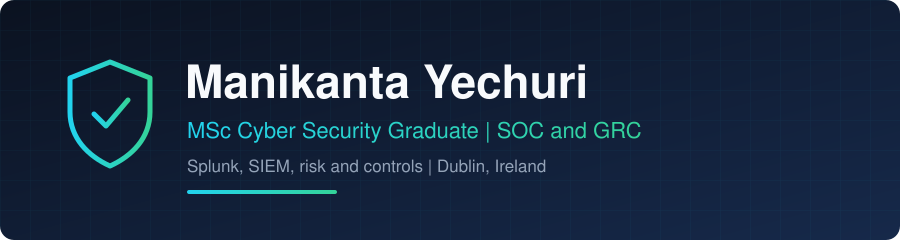

  

  
  
  

## Hi, I'm Mani

I finished an MSc in Computing in Applied Cyber Security at TU Dublin (graduating 31 October 2026, Second Class Honours Grade 1). I'm looking for a graduate role in a SOC, GRC or security risk team in Dublin.

Before the Master's I spent about three years in industry: web development at Larams Media and a compliance and policy role at Wipro. I like work where you follow evidence, write down what you found and explain it clearly.

## What I'm working on

| Project | What it is |
|---------|-----------|
| [**SIEM Lab Portfolio**](https://github.com/ygnsmk2031/siem-lab-portfolio) | Home SIEM labs with write-ups. Lab 1 (Splunk) is done: Windows and Sysmon logs, detections for a port scan and an SMB brute-force attempt, and an incident report. Sentinel and Wazuh labs are next. |
| [**FoodRush AppSec Assessment**](https://github.com/ygnsmk2031/foodrush-appsec-assessment) | Security assessment of a Django web app. STRIDE threat model, OWASP ASVS Level 1, and seven attacks run against an unpatched and a patched build. |
| **Dissertation** | Trustworthy graph-based intrusion detection for IoT networks. |

## Toolbox

## Focus areas

- **SOC and detection:** getting endpoint logs into a SIEM, writing searches, turning them into alerts, mapping to MITRE ATT&CK
- **GRC and risk:** business impact analysis, control selection, security programme proposals
- **Application security:** threat modelling, ASVS verification, hands-on testing
- **Phishing analysis:** SPF, DKIM, DMARC checks and indicators of compromise

## Currently

- Building Lab 2 (Microsoft Sentinel) and Lab 3 (Wazuh)
- Working towards the TryHackMe Security Analyst Level 1 certification

If you are hiring graduates in Dublin, I would be glad to hear from you on [LinkedIn](https://www.linkedin.com/in/manikanta-yechuri-0182631a9).
